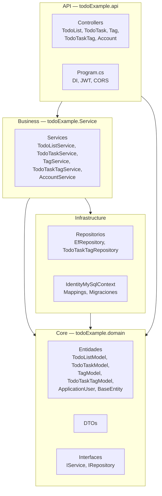
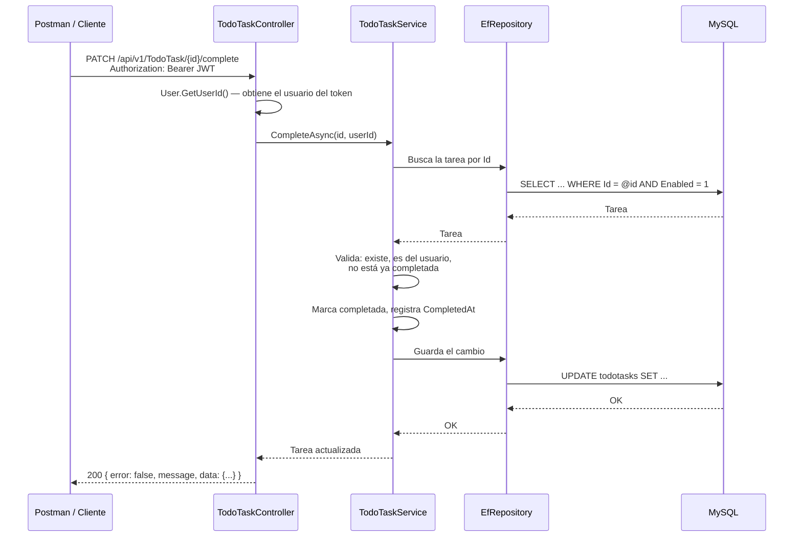

# 03 Arquitectura general

## 3.1 Capas

El proyecto usa arquitectura de cebolla. La arquitectura de cebolla organiza el código en capas concéntricas. El centro no depende de nadie; las capas externas dependen de las internas. Esto permite cambiar la base de datos o la API sin reescribir las reglas de negocio.

| Capa | Proyecto | Responsabilidad |
|---|---|---|
| Core | `todoExample.domain` | Entidades, DTOs e interfaces. No depende de ninguna otra capa. |
| Infrastructure | `todoExample.MysqlDAL` | Acceso a datos con Entity Framework: contexto, mappings, migraciones y repositorios. |
| Business | `todoExample.Service` | Reglas de negocio. Decide qué se puede hacer y qué no. |
| API | `todoExample.api` | Recibe peticiones HTTP, llama a los services y devuelve respuestas. |

El proyecto `todoExample.DapperDAL` quedó del inicio del trabajo, cuando se usaba Dapper. Ya no se usa. Está pendiente decidir si se borra. Ver [[13 Pendientes y mejoras]].

## 3.2 Recorrido de una petición

Ejemplo: completar una tarea.

La petición pasa siempre en el mismo orden: Controller → Service → Repository → MySQL, y la respuesta regresa por el mismo camino. El controller no aplica reglas de negocio y el repository no decide si algo está permitido. Esa separación es la razón de las capas.

## 3.3 Dependencias

La inyección de dependencias (DI) es el mecanismo por el que .NET crea y entrega automáticamente las clases que cada componente necesita, si están registradas en `Program.cs`. Un controller no crea su service con `new`; lo recibe en el constructor. Esto facilita probar y cambiar implementaciones.

Los services, los repositorios y el contexto de Entity Framework se registran en `Program.cs`, junto con la autenticación JWT y la configuración de CORS.
