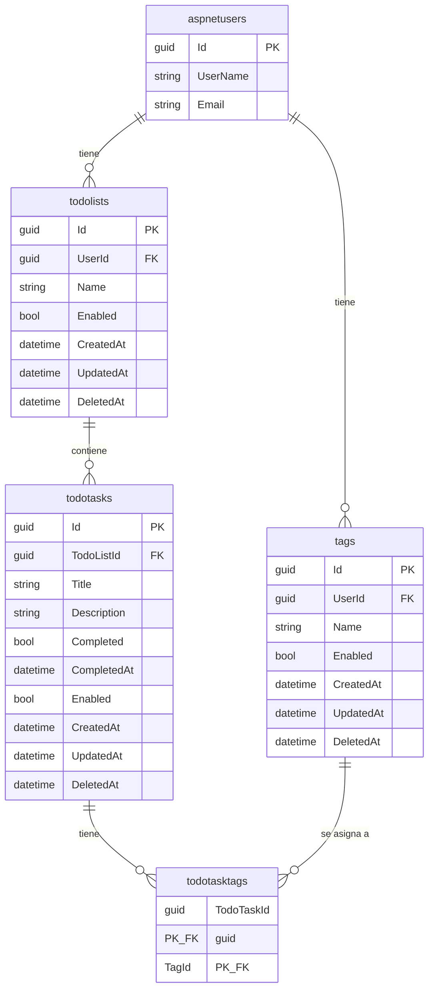

# 04 Base de datos

## 4.1 Por qué MySQL

El proyecto usa MySQL como base de datos relacional. Una base de datos relacional guarda los datos en tablas con filas y columnas, y relaciona las tablas entre sí con llaves foráneas. MySQL se eligió por decisión del equipo, junto con .NET y Entity Framework. Ver [[11 Decisiones de diseño]].

## 4.2 Tablas

| Tabla | Contenido |
|---|---|
| `aspnetusers` | Usuarios de ASP.NET Identity. Su Id es un Guid. |
| `todolists` | Listas de tareas. Pertenecen a un usuario. |
| `todotasks` | Tareas. Pertenecen a una lista. |
| `tags` | Etiquetas. Pertenecen a un usuario. |
| `todotasktags` | Tabla intermedia entre tareas y tags. Llave compuesta `TodoTaskId` + `TagId`. |

Todas las entidades de negocio heredan de `BaseEntity`: `Id` (Guid), `Enabled`, `CreatedAt`, `UpdatedAt` y `DeletedAt`.

`Enabled` implementa el borrado lógico (soft delete). El borrado lógico marca una fila como deshabilitada en lugar de borrarla. Lo deshabilitado se trata como inexistente y responde 404.

## 4.3 Diagrama entidad-relación

## 4.4 Relaciones

- Un usuario tiene muchas listas. Una lista pertenece a un usuario.
- Un usuario tiene muchos tags. Un tag pertenece a un usuario.
- Una lista tiene muchas tareas. Una tarea pertenece a una lista.
- Una tarea tiene muchos tags y un tag se asigna a muchas tareas. Es una relación muchos a muchos, que se resuelve con la tabla intermedia `todotasktags`.

Todas las relaciones usan `Restrict`: no se borra nada en cascada. Al borrar un padre con hijos, la base de datos lo impide; las reglas de borrado las decide el service. Por ejemplo, no se puede eliminar una lista con tareas pendientes.

Cada relación se declara una sola vez, en el mapping de la entidad hija, es decir, la que tiene la llave foránea.
