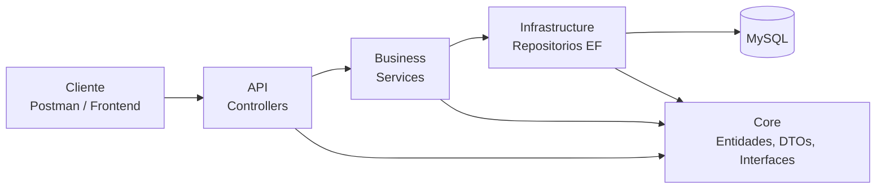

# Manual ToDo API

**Versión:** 1.0 (borrador)
**Fecha:** 10 de noviembre de 2026
**Autor:** Carlos Aram Villagran Cardenas
**Audiencia:** desarrolladores que necesiten entender, ejecutar o mantener el proyecto
**Alcance v1.0:** solo backend y base de datos. El frontend se documenta cuando se termine.

> Este manual se escribe en Obsidian en Markdown y se entrega en Word. Cada versión del Word va a la carpeta `docs/` del repositorio y se envía a Omar o Julio para revisión por secciones.

## Mapa general

## Secciones

1. [[01 Introducción]]
2. [[02 Puesta en marcha]]
3. [[03 Arquitectura general]]
4. [[04 Base de datos]]
5. [[05 Core]]
6. [[06 Infrastructure]]
7. [[07 Business]]
8. [[08 API]]
9. [[09 Referencia de endpoints]]
10. [[10 Pruebas]]
11. [[11 Decisiones de diseño]]
12. [[12 Problemas y soluciones]]
13. [[13 Pendientes y mejoras]]
14. [[14 Glosario]]

## Notas relacionadas

- [[Escuela vs mundo real]]
- [[14 Glosario]]

## Historial de versiones

| Versión | Fecha | Autor | Cambio |
|---|---|---|---|
| 1.0 borrador | 2026-11-10 | Aram Villagran | Estructura completa, sección 01 redactada, diagramas de arquitectura, entidad-relación y secuencia |
